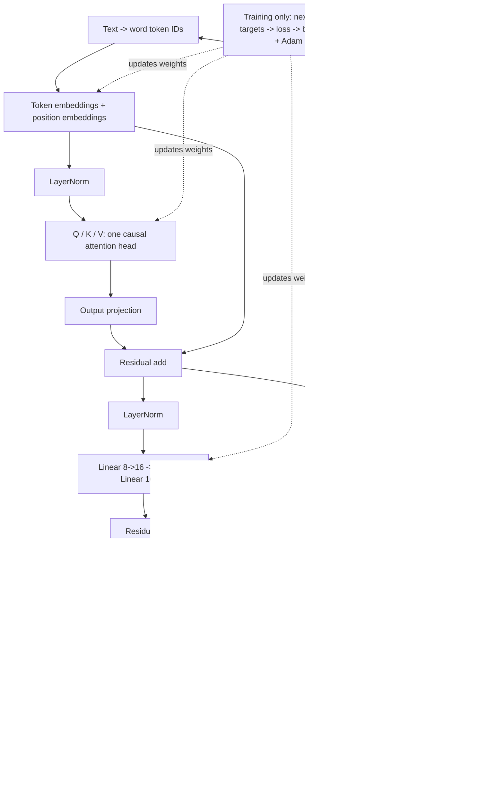

# 00 - How a tiny transformer predicts a token

**10 minutes. No prior AI knowledge or matrix mathematics required.**

Start here, before prompt engineering. Predict, run, inspect, then change one
thing. This is a real, small decoder-only transformer implemented in JavaScript,
not a recorded animation, lookup table, pretrained GPT, or explanation from an
Azure OpenAI chat response.

## Run

The [shared Azure setup](../../README.md#run-the-agent-labs-entirely-in-azure)
already provides the CPU and result persistence. No new Azure service, package,
GPU, or model deployment is needed:

```sh
# Package the latest implementation into the existing Azure job.
npm run deploy:agents -- --confirm-costs
npm run azure:agents -- 00-tiny-transformer
npm run gallery
npm run deck -- --allow-missing-recordings
npm run publish -- --include-deck
npm run verify
```

For a quick CPU-only local run, without Azure login or configuration:

```sh
node labs/00-tiny-transformer/demo.mjs
```

The local run is not Azure execution. The Azure job trains the same code inside
Azure and persists the actual measured results. There are **zero Azure OpenAI
API requests**: toy token counts are not API usage. Azure job execution and
monitoring still incur their normal charges.

## Follow one prediction

1. **Tokenize:** split space-separated words and punctuation into IDs from a
   nine-token vocabulary. `<bos>` and `<eos>` mark beginning and end. Real LLMs
   usually use subword tokenizers, not this deliberately small word vocabulary.
2. **Embed:** look up an eight-number token vector and add a learned position
   vector. Numbers are learned parameters, not manually assigned word meanings.
3. **Attend:** normalize each position, project query/key/value vectors, and
   compare queries with keys. A causal mask permits only earlier positions and
   the current position. Softmax gives attention weights; use these to mix value
   vectors, project back, and add the original input through a residual path.
4. **Transform:** normalize, expand from 8 to 16 numbers, apply ReLU, project
   back to 8, and add the second residual. This feed-forward network operates
   separately at each token position.
5. **Predict:** final normalization and a learned linear readout give nine
   logits (scores). Softmax converts them into next-token probabilities.
6. **Repeat:** take the highest-probability token at the last position, append
   it, and run again. This lab uses greedy decoding, not random sampling.

The architecture uses **one block, one attention head, 833 parameters, and an
eight-token context**. Biases and learned LayerNorm gains/offsets are included.
Full-sequence recomputation keeps the loop visible; there is no KV cache.

## Three experiments

### 1. Learn weights, then change the context

Train from seeded initialization (seed 42) on just:

```text
the robot is blue .
the plant is green .
```

Each training input is paired with the next token as its target. The runner
performs 400 Adam updates with cross-entropy loss, actual backpropagation,
learning rate 0.02, and per-parameter gradient clipping to [-1, 1]. Inspect the
measured loss curve and before/after weight fingerprints.

Compare `<bos> the robot is` with `<bos> the plant is`. The final input token is
the same, but context changes the color prediction. The evaluator requires
P(blue | robot) and P(green | plant) above 0.85, and at least a 50% loss reduction.

The shared prefix cannot uniquely predict robot versus plant: both occur in
training. Consequently, mean training loss should not be expected to reach zero.
This intentionally overfit model has not learned general facts about robots.

### 2. Try to peek at a future token

Change position 4 from blue to green in a longer input. Predictions at earlier
positions 0-3 must remain unchanged, and future attention weights must be zero.
The runner also measures a deliberately **unmasked** control to show that this
is a real information boundary rather than a model ignoring all context.

In the numeric trace, `null` future scores represent masked-out entries,
equivalent to negative infinity before softmax. Their attention weights are
exactly zero, not missing measurements.

### 3. Append one token

Start with `<bos> the robot`. Inspect each computed distribution as the model
appends `is`, `blue`, `.`, and `<eos>`. End-of-sequence stops generation.
Before/after fingerprints verify that inference did not change weights.

## Proposed architecture diagram

Use the [full-size SVG](../../web/transformer.svg) as the classroom poster. It is
also published with the gallery and linked from the teaching deck. Solid arrows
show inference; the separate amber panel describes training.



**Teacher caution:** attention weights describe mixing coefficients, not a
complete explanation of a model's reasoning. Probabilities are relative to the
toy model and its training distribution, not calibrated truth scores. The model
can memorize two sentences without understanding or generalizing like an LLM.

**Try:** change the two training sentences using the existing vocabulary,
retrain, and update the behavior checks. Inputs outside the vocabulary or
context length fail explicitly. Prompting alone cannot teach a new token.

**Evidence:** `results/00-tiny-transformer.json` contains the vocabulary, IDs,
embeddings, positions, Q/K/V vectors, masked scores, attention weights, residuals,
feed-forward activations, logits, probabilities, loss curve, and generation
steps. Saved Azure execution metadata distinguishes cloud from local runs.
