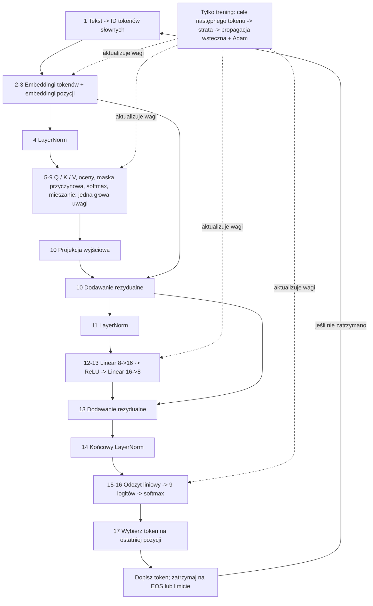

# 00 — Jak mały transformer przewiduje token

[English](readme.md) | [Polski](readme.pl.md)

**Język galerii:** przełącznik zmienia tekst dydaktyczny i udostępnia polskie tłumaczenia promptów do ćwiczeń. Oryginalne zapisane prompty, odpowiedzi modeli i metryki pozostają bez zmian. Tłumaczenia służą nauczaniu — nie są zmyślonymi wynikami polskich wywołań API.

**15 minut. Nie jest wymagana wcześniejsza wiedza o AI ani rachunku macierzowym.**

Zacznij tutaj, przed projektowaniem promptów. Najpierw przewidź wynik, uruchom,
sprawdź, a potem zmień jedną rzecz. To prawdziwy, mały transformer typu
decoder-only zaimplementowany w JavaScripcie, a nie nagrana animacja, tablica
gotowych odpowiedzi, wstępnie wytrenowany GPT ani objaśnienie z odpowiedzi
czatu Azure OpenAI.

## Uruchomienie

[Wspólna konfiguracja Azure](../../README.md#run-the-agent-labs-entirely-in-azure)
zapewnia już CPU i trwały zapis wyników. Nie potrzeba nowej usługi Azure,
pakietu, GPU ani wdrożenia modelu:

```sh
# Package the latest implementation into the existing Azure job.
npm run deploy:agents -- --confirm-costs
npm run azure:agents -- 00-tiny-transformer
npm run gallery
npm run deck -- --allow-missing-recordings
npm run publish -- --include-deck
npm run verify
```

Pierwsze polecenie pakuje najnowszą implementację do istniejącego zadania Azure.
Aby szybko uruchomić lokalnie na samym CPU, bez logowania do Azure i konfiguracji:

```sh
node labs/00-tiny-transformer/demo.mjs
```

Lokalne uruchomienie wypisuje wyniki wszystkich pięciu eksperymentów, a następnie
pełne omówienia krok po kroku (około 750 wierszy: każde równanie, jego wyjaśnienie
prostymi słowami i rzeczywiste liczby). Nie jest to wykonanie w Azure.
Zadanie Azure trenuje ten sam kod wewnątrz Azure i utrwala rzeczywiście zmierzone
wyniki. Liczba **żądań API Azure OpenAI wynosi zero**: tokeny miniaturowego modelu
nie są zużyciem API. Wykonanie zadania Azure i monitorowanie nadal podlegają
zwykłym opłatom.

## Prześledź jedną predykcję krok po kroku

W galerii wybierz **Prześledź jedną predykcję przez wszystkie kroki**
(ang. **Follow one prediction through every step**) albo uruchom demonstrację
na CPU, aby prześledzić `<bos> the robot is` w wytrenowanym modelu.
Każdy z 17 kroków pokazuje trzy rzeczy:

1. **Prostymi słowami:** co się dzieje, bez żargonu.
2. **Równanie:** wzór realizowany przez kod.
3. **Liczby z tego uruchomienia:** rzeczywiste wartości z wytrenowanego modelu,
   pozwalające sprawdzić równanie kalkulatorem.

| # | Prostymi słowami | Równanie |
| --- | --- | --- |
| 1 | Zamień słowa na numery ID | `id_i = index(word_i)` |
| 2 | Odszukaj wektor każdego słowa | `e_i = E[id_i]` |
| 3 | Dodaj informację o miejscu słowa w zdaniu | `x_i = e_i + p_i` |
| 4 | Przeskaluj liczby (jak przy regulacji głośności) | `n[k] = g[k] · (x[k] − μ) / √(σ² + ε) + β[k]` |
| 5 | Utwórz zapytanie (Query), klucz (Key) i wartość (Value) dla każdego słowa | `q_i = W_Q · n_i + b_Q` (tak samo dla `k`, `v`) |
| 6 | Porównaj zapytanie z każdym kluczem | `s_ij = (q_i · k_j) / √8` |
| 7 | Ukryj przyszłość | `s_ij = −∞  whenever j > i` |
| 8 | Zamień wyniki porównań na procentowe wagi uwagi | `α_ij = exp(s_ij) / (exp(s_i1) + exp(s_i2) + … + exp(s_ii))` |
| 9 | Wymieszaj wartości według tych wag | `m_i = α_i1·v_1 + α_i2·v_2 + … + α_ii·v_i` |
| 10 | Przekształć mieszankę i dodaj połączenie skrótowe | `r_i = x_i + (W_O · m_i + b_O)` |
| 11 | Ponownie przeskaluj | `u[k] = g[k] · (r[k] − μ) / √(σ² + ε) + β[k]` |
| 12 | Przetwórz każde słowo osobno: 16 detektorów, potem wyzeruj wartości ujemne | `h[j] = ReLU( W_1[j,1]·u[1] + … + W_1[j,8]·u[8] + b_1[j] )` |
| 13 | Wróć do 8 liczb i dodaj drugie połączenie skrótowe | `y_i = r_i + (W_2 · h_i + b_2)` |
| 14 | Przeskaluj po raz ostatni | `t[k] = g[k] · (y[k] − μ) / √(σ² + ε) + β[k]` |
| 15 | Nadaj ocenę każdemu słowu w słowniku | `z[w] = W_R[w,1]·t[1] + … + W_R[w,8]·t[8] + b_R[w]` |
| 16 | Zamień oceny na prawdopodobieństwa | `P(w) = exp(z[w]) / (exp(z[1]) + … + exp(z[9]))` |
| 17 | Wybierz następne słowo i powtórz | `next word = argmax_w P(w)` |

W kroku 7 `whenever j > i` oznacza „zawsze, gdy j > i”; w kroku 17
`next word` oznacza „następne słowo”. Zapis równań pozostawiono jak w oryginale.

Kroki 1–3 przygotowują słowa, 4–10 to mechanizm uwagi (spojrzenie na wcześniejsze
słowa), 11–13 to sieć feed-forward (każde słowo jest przetwarzane osobno),
a 14–17 tworzą predykcję. Końcowa karta **Dlaczego po „robot is” pojawia się „blue”,
a po „plant is” — „green”** porównuje oba zdania: słowo `is` początkowo jest
identyczne w obu przypadkach (kroki 3 i 5). Jedynym sposobem ustalenia, jaki
rzeczownik je poprzedzał, jest spojrzenie wstecz w krokach 6–9.

Uwagi dla uczniów i nauczycieli:

- Obserwujemy ostatnie słowo, `is`, ponieważ jego wyjście przewiduje następne
  słowo. W równaniach `i` jest słowem, które „pyta”, a `j` — słowem, na które
  spogląda. Strona liczy od 1 („pierwsza liczba”); identyfikatory słownika zaczynają się od 0.
- Wyświetlane liczby są zaokrąglone do trzech miejsc po przecinku, więc ręczne
  obliczenia mogą różnić się ostatnią cyfrą.
- **Sprawdź samodzielnie:** w kroku 6 pomnóż osiem par liczb z przykładu,
  dodaj iloczyny i podziel przez √8 ≈ 2.828. Wynik powinien zgadzać się
  z wyświetloną oceną. Krok 8 zamienia te oceny na procenty.
- Omówienie jest drugą, niezależną implementacją: zwykłe liczby JavaScriptu
  przetwarzane dokładnie według tych równań, porównane z własnym przebiegiem
  w przód transformera (największa różnica około 3e-15). Ewaluator dodatkowo
  odtwarza każdy przykład obliczeniowy, sumę, softmax i połączenie rezydualne
  na podstawie zapisanych liczb. Liczba niespełniająca swojego równania
  powoduje niezaliczenie laboratorium.
- Procentowe wagi uwagi opisują mieszanie informacji. Nie są pełnym
  wyjaśnieniem tego, co model „myśli”; ten miniaturowy model zapamiętał dwa zdania.

## Zobacz jedną aktualizację treningową

Wybierz **Zobacz jedną aktualizację treningową** (ang. **See one training update**),
aby prześledzić uczenie w taki sam sposób, z rzeczywistymi liczbami z niewytrenowanego
modelu z ziarnem losowym 42:

| # | Prostymi słowami | Równanie |
| --- | --- | --- |
| 1 | Zmierz, jak bardzo model się myli | `L = −(ln P_1 + ln P_2 + … + ln P_N) / N` |
| 2 | Ustal, w którą stronę lekko zmienić liczbę | `slope = ∂L/∂w ≈ (L(w + δ) − L(w − δ)) / (2δ)` |
| 3 | Zmień odrobinę każdą liczbę | `w_new = w − η · g / (\|g\| + 0.00000001)` |
| 4 | Powtórz 400 razy | przeczytaj dane, zmierz `L`, znajdź nachylenia, lekko zmień każde `w` |

W kroku 2 nachylenie funkcji straty względem jednego uczonego parametru mierzymy
dwukrotnie: propagacją wsteczną oraz metodą bezpośrednią (zwiększamy i zmniejszamy
liczbę o 0.00001, po czym porównujemy obie straty). Wyniki zgadzają się
z dokładnością około 1e-11. Krok 3 stosuje do tej liczby pierwszą aktualizację
Adam, porównuje wynik z pierwszą aktualizacją rzeczywistego treningu i pokazuje,
że już jedna aktualizacja obniża średnią stratę.

Architektura obejmuje **jeden blok, jedną głowę uwagi, 833 parametry i kontekst
ośmiu tokenów**. Wliczono wyrazy wolne oraz uczone współczynniki skali
i przesunięcia LayerNorm. Ponowne obliczanie całej sekwencji pozwala widzieć
działanie pętli; nie ma pamięci podręcznej KV.

## Pięć eksperymentów

### 1. Wyucz wagi, a potem zmień kontekst

Trenuj od inicjalizacji z ustalonym ziarnem losowym (42), wyłącznie na:

```text
the robot is blue .
the plant is green .
```

Każdemu wejściu treningowemu przypisany jest następny token jako cel.
Skrypt wykonuje 400 aktualizacji Adam, używając straty entropii krzyżowej,
rzeczywistej propagacji wstecznej, współczynnika uczenia 0.02 i przycinania
gradientu każdego parametru do [-1, 1]. Sprawdź zmierzoną krzywą straty
i odciski wag przed treningiem i po nim.

Porównaj `<bos> the robot is` z `<bos> the plant is`. Ostatni token wejścia jest
ten sam, ale kontekst zmienia przewidywany kolor. Ewaluator wymaga, aby
P(blue | robot) i P(green | plant) przekraczały 0.85, a strata spadła o co najmniej 50%.

Wspólny prefiks nie pozwala jednoznacznie przewidzieć robot lub plant: oba
występują w treningu. Nie należy więc oczekiwać, że średnia strata treningowa
spadnie do zera. Ten celowo przeuczony model nie poznał ogólnych faktów o robotach.

### 2. Prześledź jedną predykcję przez wszystkie kroki

Opisane wyżej 17 kroków dla `<bos> the robot is`, z porównaniem do
`<bos> the plant is`. Ewaluator wymaga, aby każdy krok zawierał wyjaśnienie
prostymi słowami, równanie i liczby; każdy przykład obliczeniowy i zależność
odtwarzały zapisane wartości; implementacja na zwykłych liczbach zgadzała się
z przebiegiem w przód transformera z dokładnością 1e-9; a końcowe prawdopodobieństwa
z omówienia były równe zapisanej predykcji z pierwszego eksperymentu.

### 3. Zobacz jedną aktualizację treningową

Opisane wyżej cztery kroki uczenia. Ewaluator wymaga zgodności nachylenia
z propagacji wstecznej z testem niewielkiej zmiany parametru, zgodności pierwszej
aktualizacji z rzeczywistą pierwszą aktualizacją treningową, spadku średniej
straty po jednej aktualizacji oraz tego, by zapisana krzywa straty pochodziła
z tego samego treningu.

### 4. Spróbuj podejrzeć przyszły token

W dłuższym wejściu zmień pozycję 4 z blue na green. Predykcje na wcześniejszych
pozycjach 0–3 muszą pozostać bez zmian, a wagi uwagi dla przyszłych pozycji
muszą wynosić zero. Skrypt mierzy też celowo **niezamaskowany** wariant kontrolny,
aby pokazać, że to rzeczywista granica przepływu informacji, a nie ignorowanie
całego kontekstu przez model.

W śladzie liczbowym przyszłe oceny `null` oznaczają zamaskowane pozycje,
równoważne minus nieskończoności przed softmax. Ich wagi uwagi wynoszą dokładnie
zero — nie są brakującymi pomiarami.

### 5. Dopisz jeden token

Zacznij od `<bos> the robot`. Sprawdzaj każdy obliczony rozkład, gdy model
dopisuje `is`, `blue`, `.`, a następnie `<eos>`. Koniec sekwencji zatrzymuje
generowanie. Odciski przed i po potwierdzają, że wnioskowanie nie zmieniło wag.

## Proponowany schemat architektury

Użyj [pełnowymiarowego SVG](../../web/transformer.svg) jako plakatu w klasie.
Jest również publikowany z galerią i podlinkowany w prezentacji dydaktycznej.
Ciągłe strzałki pokazują wnioskowanie, a osobny bursztynowy panel opisuje trening.
Panel słownika na plakacie wymienia każde słowo z jego ID (ID to miejsce słowa
w dziewięcioelementowym słowniku, liczone od 0), więc można odczytać znaczenie
liczb w polu 1. Numery kroków na poniższym schemacie i znaczniki `#` na plakacie
odpowiadają omówieniu krok po kroku.



**Uwaga dla nauczyciela:** wagi uwagi opisują współczynniki mieszania, a nie
pełny tok rozumowania modelu. Prawdopodobieństwa odnoszą się do miniaturowego
modelu i jego rozkładu treningowego, a nie do skalibrowanych ocen prawdziwości.
Model może zapamiętać dwa zdania, nie rozumiejąc i nie uogólniając tak jak LLM.

**Wypróbuj:** zmień oba zdania treningowe, używając istniejącego słownictwa,
wytrenuj ponownie i zaktualizuj kontrole zachowania. Wejście spoza słownika
lub przekraczające długość kontekstu kończy się jawnym błędem.
Sam prompt nie może nauczyć modelu nowego tokenu.

**Dowody:** `results/00-tiny-transformer.json` zawiera słownik, ID, embeddingi,
pozycje, wektory Q/K/V, zamaskowane oceny, wagi uwagi, połączenia rezydualne,
aktywacje feed-forward, logity, prawdopodobieństwa, krzywą straty i kroki
generowania. Zawiera też oba omówienia: dla każdego kroku równania, wyjaśnienie
prostymi słowami, wyświetlane tabele i liczby z pełną precyzją, których ewaluator
używa do ponownego wyprowadzenia każdego równania. Zapisane metadane wykonania
Azure odróżniają uruchomienia w chmurze od lokalnych.
