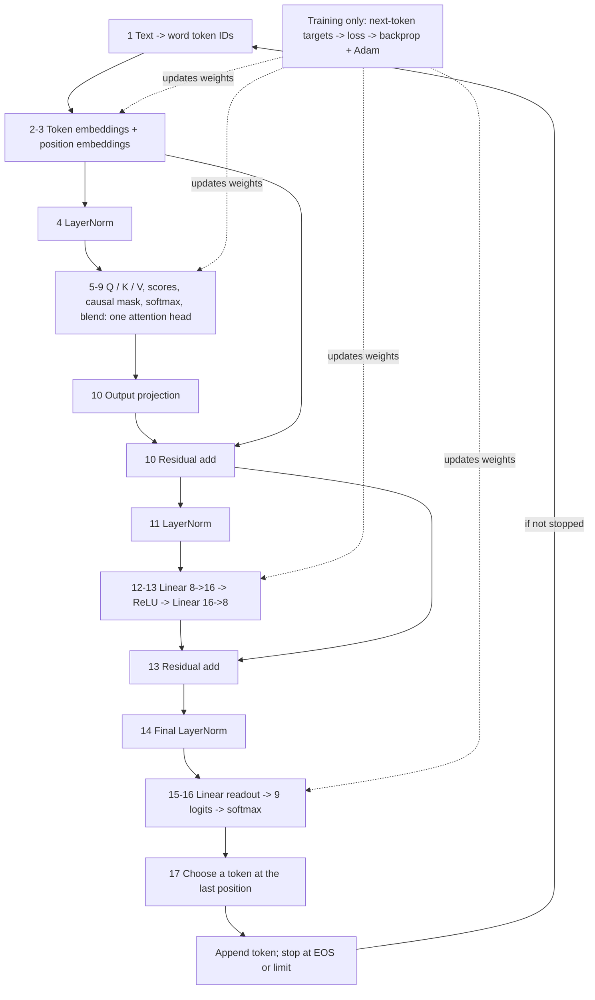

# 00 - How a tiny transformer predicts a token

[English](00-tiny-transformer.en.md) | [Polski](00-tiny-transformer.pl.md)

**Language note:** the gallery language selector switches teaching text and provides Polish practice-prompt translations. Original recorded prompts, model output, and metrics remain unchanged; translations are teaching aids, not fabricated Polish API outcomes.

**15 minutes. No prior AI knowledge or matrix mathematics required.**

Start here, before prompt engineering. Predict, run, inspect, then change one
thing. This is a real, small decoder-only transformer implemented in JavaScript,
not a recorded animation, lookup table, pretrained GPT, or explanation from an
Azure OpenAI chat response.

## Run

The [shared Azure setup](../../README.md#run-the-agent-labs-entirely-in-azure)
already provides the CPU and result persistence. No new Azure service, package,
GPU, or model deployment is needed:

```sh
# Package the latest implementation into the existing Azure job.
npm run deploy:agents -- --confirm-costs
npm run azure:agents -- 00-tiny-transformer
npm run gallery
npm run deck -- --allow-missing-recordings
npm run publish -- --include-deck
npm run verify
```

For a quick CPU-only local run, without Azure login or configuration:

```sh
node labs/00-tiny-transformer/demo.mjs
```

The local run prints the results of all five experiments and then the complete step-by-step walkthroughs (about
750 lines: every equation, its plain-words explanation, and the real numbers). It is not Azure execution. The
Azure job trains the same code inside
Azure and persists the actual measured results. There are **zero Azure OpenAI
API requests**: toy token counts are not API usage. Azure job execution and
monitoring still incur their normal charges.

## Follow one prediction, step by step

Choose **Follow one prediction through every step** in the gallery, or run the CPU demo, to follow
`<bos> the robot is` through the trained model. Each of the 17 steps shows three things:

1. **In plain words:** what happens, without jargon.
2. **The equation:** the formula the code implements.
3. **This run's numbers:** the real values from the trained model, so you can check an equation with a calculator.

| # | In plain words | Equation |
| --- | --- | --- |
| 1 | Turn the words into ID numbers | `id_i = index(word_i)` |
| 2 | Look up each word's vector | `e_i = E[id_i]` |
| 3 | Add the word's place in the sentence | `x_i = e_i + p_i` |
| 4 | Rescale the numbers (like setting the volume) | `n[k] = g[k] · (x[k] − μ) / √(σ² + ε) + β[k]` |
| 5 | Make a Query, a Key and a Value for every word | `q_i = W_Q · n_i + b_Q` (same for `k`, `v`) |
| 6 | Compare the question with every label | `s_ij = (q_i · k_j) / √8` |
| 7 | Hide the future | `s_ij = −∞  whenever j > i` |
| 8 | Turn the scores into attention percentages | `α_ij = exp(s_ij) / (exp(s_i1) + exp(s_i2) + … + exp(s_ii))` |
| 9 | Blend the Values using those percentages | `m_i = α_i1·v_1 + α_i2·v_2 + … + α_ii·v_i` |
| 10 | Tidy the blend and add a shortcut | `r_i = x_i + (W_O · m_i + b_O)` |
| 11 | Rescale again | `u[k] = g[k] · (r[k] − μ) / √(σ² + ε) + β[k]` |
| 12 | Think alone: 16 detectors, then switch the negative ones off | `h[j] = ReLU( W_1[j,1]·u[1] + … + W_1[j,8]·u[8] + b_1[j] )` |
| 13 | Squeeze back to 8 numbers and add a second shortcut | `y_i = r_i + (W_2 · h_i + b_2)` |
| 14 | One last rescale | `t[k] = g[k] · (y[k] − μ) / √(σ² + ε) + β[k]` |
| 15 | Give every dictionary word a score | `z[w] = W_R[w,1]·t[1] + … + W_R[w,8]·t[8] + b_R[w]` |
| 16 | Turn the scores into probabilities | `P(w) = exp(z[w]) / (exp(z[1]) + … + exp(z[9]))` |
| 17 | Pick the next word, then repeat | `next word = argmax_w P(w)` |

Steps 1-3 get the words ready, 4-10 are attention (look back at earlier words), 11-13 are the feed-forward network
(each word thinks alone), and 14-17 make the prediction. A final card, **Why "robot is" gives "blue" but "plant is"
gives "green"**, compares the two sentences: the word `is` starts out identical in both (steps 3 and 5), and the
only way it can learn which noun came before is by looking back at it in steps 6-9.

Notes for students and teachers:

- We watch the last word, `is`, because its output predicts the next word. In the equations, `i` is the word that is
  asking and `j` is a word it looks at. The page counts from 1 ("the first number"); the dictionary IDs start at 0.
- Numbers are rounded to three decimals on display, so doing the arithmetic by hand can differ in the last digit.
- **Check one yourself:** in step 6, multiply the eight pairs in the worked example, add them up, and divide by
  √8 ≈ 2.828. You should get the printed score. Step 8 then turns those scores into the percentages.
- The walkthrough is a second, independent implementation: plain JavaScript numbers following exactly these
  equations, cross-checked against the transformer's own forward pass (largest difference about 3e-15). The
  evaluator also re-derives every worked example, sum, softmax and residual from the recorded numbers, so a
  number that does not satisfy its equation fails the lab.
- Attention percentages describe how information is mixed. They are not a complete explanation of what a model
  "thinks", and this toy model memorized two sentences.

## See one training update

Choose **See one training update** for the same treatment of learning, with real numbers from the untrained
seed-42 model:

| # | In plain words | Equation |
| --- | --- | --- |
| 1 | Measure how wrong the model is | `L = −(ln P_1 + ln P_2 + … + ln P_N) / N` |
| 2 | Find which way to nudge a number | `slope = ∂L/∂w ≈ (L(w + δ) − L(w − δ)) / (2δ)` |
| 3 | Nudge every number a little | `w_new = w − η · g / (\|g\| + 0.00000001)` |
| 4 | Repeat 400 times | read, measure `L`, find the slopes, nudge every `w` |

Step 2 measures the slope of the loss for one learned number twice: by backpropagation and by brute force (nudge the
number up and down by 0.00001 and compare the two losses). They agree to about 1e-11. Step 3 applies the first Adam
update to that number, checks the result against the first update of the real training run, and shows that one
update already lowers the average loss.

The architecture uses **one block, one attention head, 833 parameters, and an
eight-token context**. Biases and learned LayerNorm gains/offsets are included.
Full-sequence recomputation keeps the loop visible; there is no KV cache.

## Five experiments

### 1. Learn weights, then change the context

Train from seeded initialization (seed 42) on just:

```text
the robot is blue .
the plant is green .
```

Each training input is paired with the next token as its target. The runner
performs 400 Adam updates with cross-entropy loss, actual backpropagation,
learning rate 0.02, and per-parameter gradient clipping to [-1, 1]. Inspect the
measured loss curve and before/after weight fingerprints.

Compare `<bos> the robot is` with `<bos> the plant is`. The final input token is
the same, but context changes the color prediction. The evaluator requires
P(blue | robot) and P(green | plant) above 0.85, and at least a 50% loss reduction.

The shared prefix cannot uniquely predict robot versus plant: both occur in
training. Consequently, mean training loss should not be expected to reach zero.
This intentionally overfit model has not learned general facts about robots.

### 2. Follow one prediction through every step

The 17-step walkthrough above, for `<bos> the robot is`, with a comparison against `<bos> the plant is`. The evaluator
requires every step to show plain words, an equation and numbers, every worked example and relation to reproduce
the recorded numbers, the plain-number implementation to match the transformer's own forward pass to 1e-9, and the
walkthrough's final probabilities to equal the first experiment's recorded prediction.

### 3. See one training update

The four-step learning walkthrough above. The evaluator requires the backpropagation slope to match the nudge test,
the first update to match the real first training update, one update to lower the average loss, and the recorded
loss curve to be the training run's own.

### 4. Try to peek at a future token

Change position 4 from blue to green in a longer input. Predictions at earlier
positions 0-3 must remain unchanged, and future attention weights must be zero.
The runner also measures a deliberately **unmasked** control to show that this
is a real information boundary rather than a model ignoring all context.

In the numeric trace, `null` future scores represent masked-out entries,
equivalent to negative infinity before softmax. Their attention weights are
exactly zero, not missing measurements.

### 5. Append one token

Start with `<bos> the robot`. Inspect each computed distribution as the model
appends `is`, `blue`, `.`, and `<eos>`. End-of-sequence stops generation.
Before/after fingerprints verify that inference did not change weights.

## Proposed architecture diagram

Use the [full-size SVG](../../web/transformer.svg) as the classroom poster. It is
also published with the gallery and linked from the teaching deck. Solid arrows
show inference; the separate amber panel describes training. The dictionary panel
on the poster lists every word with its ID (an ID is the word's place in the
nine-word dictionary, counting from 0), so the numbers in box 1 can be decoded.
The step numbers in the diagram below and the `#` tags on the poster match the
walkthrough.



**Teacher caution:** attention weights describe mixing coefficients, not a
complete explanation of a model's reasoning. Probabilities are relative to the
toy model and its training distribution, not calibrated truth scores. The model
can memorize two sentences without understanding or generalizing like an LLM.

**Try:** change the two training sentences using the existing vocabulary,
retrain, and update the behavior checks. Inputs outside the vocabulary or
context length fail explicitly. Prompting alone cannot teach a new token.

**Evidence:** `results/00-tiny-transformer.json` contains the vocabulary, IDs,
embeddings, positions, Q/K/V vectors, masked scores, attention weights, residuals,
feed-forward activations, logits, probabilities, loss curve, and generation
steps. It also holds both walkthroughs: for every step, its equations, plain-words
text, display tables, and the full-precision numbers the evaluator uses to re-derive
each equation. Saved Azure execution metadata distinguishes cloud from local runs.
